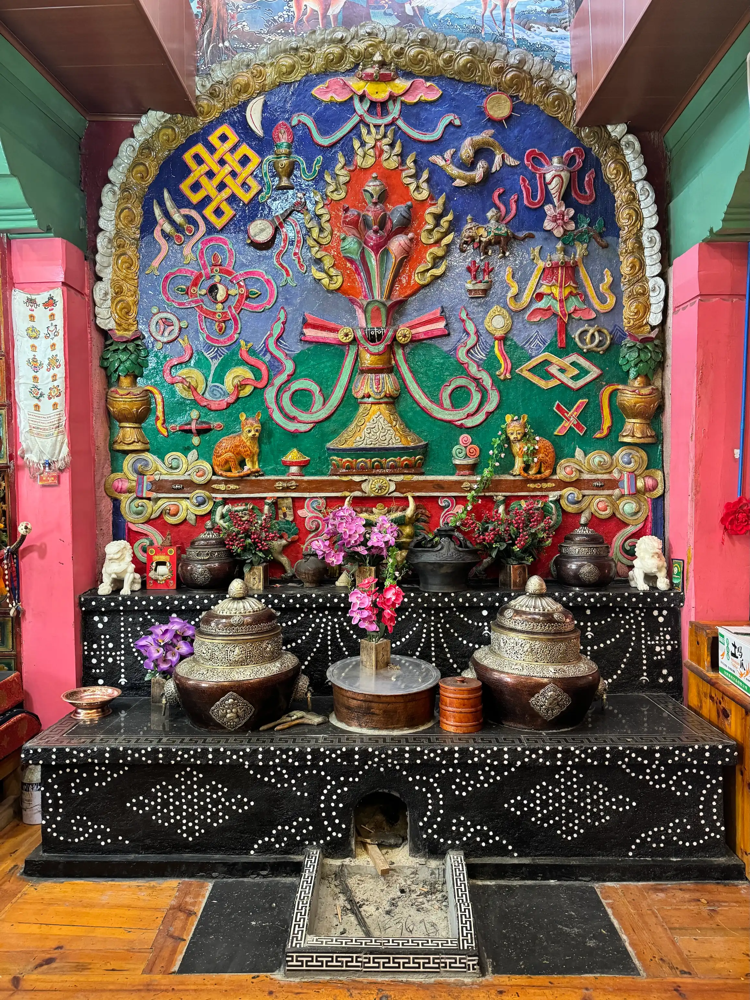
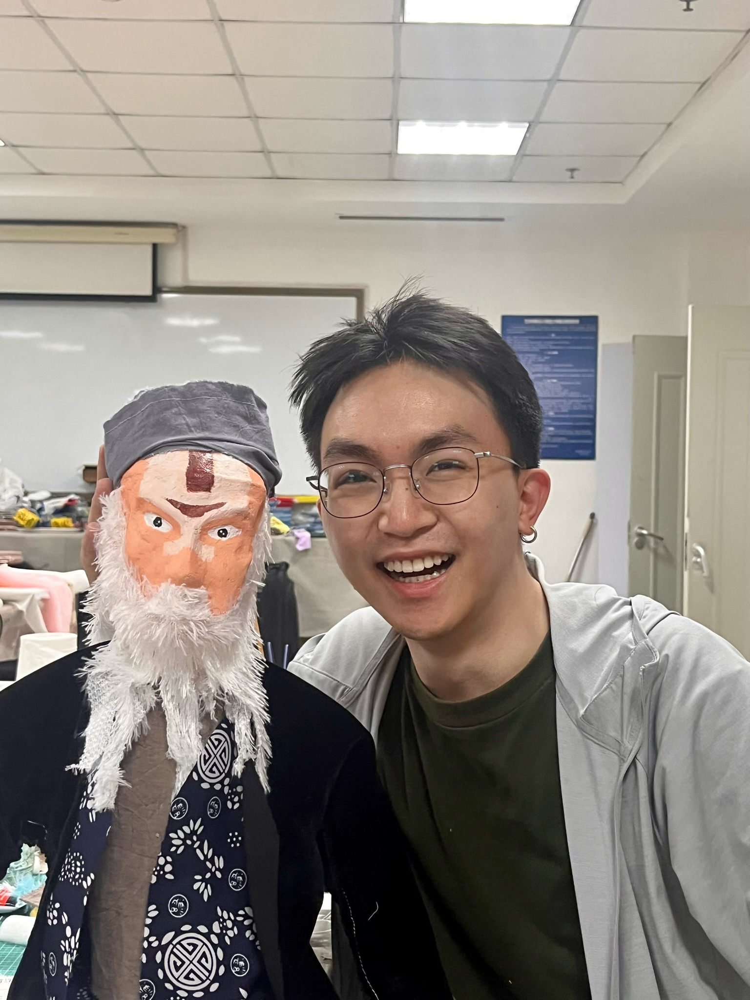
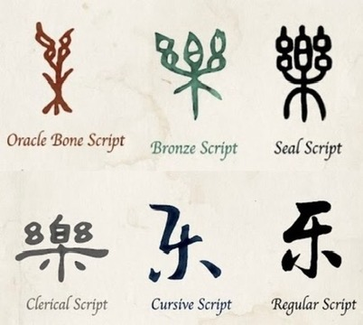
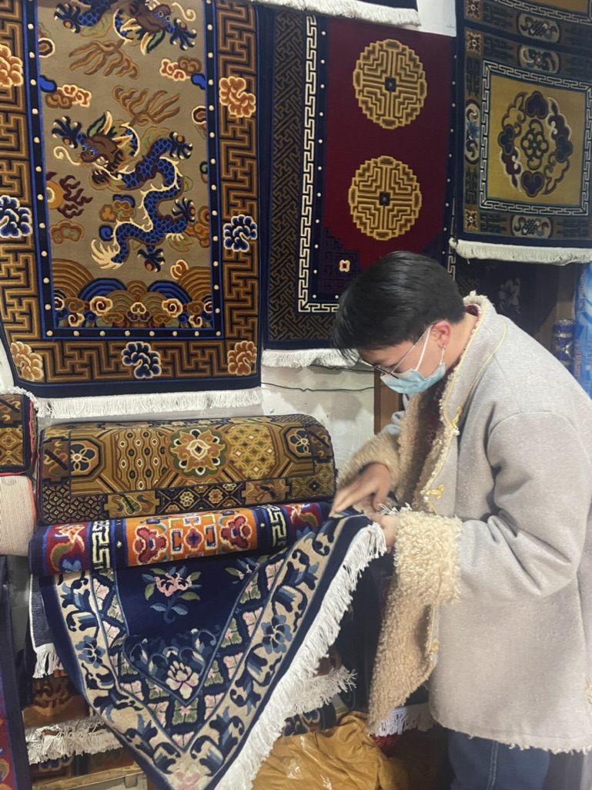
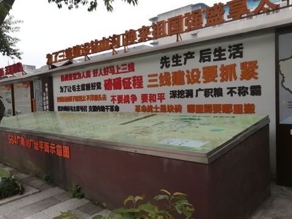
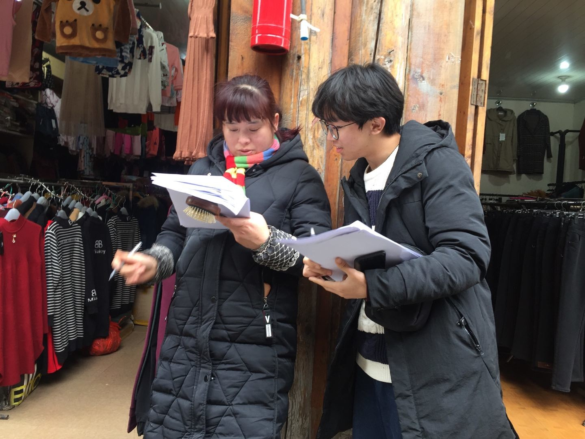

  

    

      
    

    

      <h6 class="fw-bold" style="font-family: 'MyJost', sans-serif;">The Dialogue between “Om” and “Xiang” (10/2023 – 06/2025)</h6>
      

        In my hometown of Xiangcheng, household stoves have a distinctive local style. People paint or sculpt images connected with Tibetan Buddhism on the stove walls, and the decorated stove is honoured as the Stove God. Most stoves share a similar form, but one image in particular drew my attention: cats found in almost every household. Cats are uncommon in Tibetan Buddhist iconography, so why do they appear here and receive such respect? And why do they resemble the jewel-spitting mongoose in both form and function? I began with these questions and followed them into the ways families understand and care for the images around their stoves. The stove became a way for me to explore how familiar images carry social memory and help shape local and ethnic identities. This work eventually became my master’s thesis.
      

      <a href="/projects/om-and-xiang/" class="btn btn-sm btn-outline-info" style="font-family: 'MyJost', sans-serif;">Read More</a>
    

  

  

    

      
    

    

      <h6 class="fw-bold" style="font-family: 'MyJost', sans-serif;">Embodied Knowledge and Cultural Transmission in Traditional Puppetry (06/2023 – 09/2023)</h6>
      

        Over three months, we studied theatre theory, learned to make puppets, and practiced rod-puppet performance with a local troupe. Taking part in rehearsals and performances gave me a different sense of what it means to learn a craft. When several people have to move or even dance together on a narrow stage, knowledge and information are transmitted through demonstration, repetition, and small adjustments of the body. I began to think about how a performance carries more than a story: it also carries the knowledge, memories, and relationships of the people who keep it going.
      

    

  

  

    

      
    

    

      <h6 class="fw-bold" style="font-family: 'MyJost', sans-serif;">Ecologies of Heritage: Cultural Revitalization in Rural China (11/2022 – 10/2023)</h6>
      

        On Bashao Island in Dalian, Liaoning, I conducted fieldwork on local customs and intangible cultural heritage, paying particular attention to their connections with the island’s ecology and community life. Drawing on other cases studied by my supervisor’s team, we compared experiences across rural areas and considered how cultural preservation might give greater attention to local environments and community participation. This was my first attempt to study cultural heritage in the settings where people continue to practice it. The experience brought me closer to the everyday choices through which people maintain their traditions, and showed me how closely cultural continuity is tied to the places where they live.
      

    

  

  

    

      
    

    

      <h6 class="fw-bold" style="font-family: 'MyJost', sans-serif;">From Ritual Governance to Aesthetic Transcendence: A Semiotic Genealogy of “乐” (11/2022 – 03/2023)</h6>
      

        The Chinese character “乐” has developed several readings and meanings over time: yuè for music, lè for joy and happiness, and yào for liking or appreciation. I was fascinated by the distance, and the connection, between these meanings. How did one character come to hold such different ideas? Through historical texts, I traced how its meanings developed in relation to ritual and political order, personal emotion, and aesthetic thought. Following a single character across different periods opened up questions about language, history, and the ways people have understood their experiences.
      

    

  

  

    

      
    

    

      <h6 class="fw-bold" style="font-family: 'MyJost', sans-serif;">Motifs of Change: a study of Tibetan Rugs (06/2020 – 08/2020)</h6>
      

        I was leading an animal welfare organization at university when we had the chance to carry out a research project. Our shared interest in animals, together with my background in a Tibetan region, drew us to the animal motifs on Tibetan rugs. We wanted to understand how animals were imagined and depicted, and why certain motifs had endured over time.
      

      

        As the research progressed, we found that rug patterns, colours, and production methods changed with market demand and the wider economic and policy environment. Yet some animal motifs remained relatively stable. We also studied how the rugs were produced, processed, and sold. What began as an interest in animal images gradually drew my attention to the people, materials, and circumstances that allowed those images to endure or change.
      

    

  

  

    

      
 
      

    

    

      <h6 class="fw-bold" style="font-family: 'MyJost', sans-serif;">Grassroots Governance and Community Dynamics in Urban China (11/2019 – 02/2021)</h6>
      

        During my undergraduate studies, I became interested in why resident participation worked so differently across Chengdu’s urban communities. Some award-winning communities had developed effective ways to involve residents, while others saw active participation but limited results. We decided to look more closely at several communities where local governance had worked well. Through interviews and questionnaire surveys, we explored their approaches to community participation, drew on their experiences, and proposed suggestions suited to different local conditions.
      

      

        The research also changed how I thought about politics at the grassroots level. My studies had introduced me to the roles of local governments and grassroots Party organizations, but I began to see how much also depended on residents’ everyday needs, neighborhood relationships, and the decisions people made about their shared affairs. This project later became the basis of my bachelor’s thesis.
      

    

  

  

    

      
    

    

      <h6 class="fw-bold" style="font-family: 'MyJost', sans-serif;">Visual Culture and Material Memory in Chinese Revolutionary Heritage Sites (11/2018 – 06/2019)</h6>
      

        Compared with well-known revolutionary heritage sites such as Jinggangshan, some former revolutionary base areas in Sichuan have received far less public attention, despite their historical and political significance. This led us to conduct fieldwork in Guangyuan, Luzhou, and other places. We explored how local governments and residents preserve, present, and pass on their own revolutionary histories. Through interviews, questionnaire surveys and comparisons across sites, we also proposed practical suggestions for their future development. What stayed with me was a change in how I looked at historical places and objects. They were more than reminders of events that had already passed. Their physical presence also shaped how people understood history and experienced the places around them. This was an early turning point in my interest in visual and material culture.
      

    

  

 

<!-- ==========================================
 🧙‍♂️ 强制注入：当前页面的导航栏字体与颜色魔法
 为什么要放在最下面？
 因为在 HTML 渲染时，越靠下的代码优先级越高 (Cascading)。
 放在最后能确保它覆盖掉默认主题的所有样式！
 ========================================== -->

