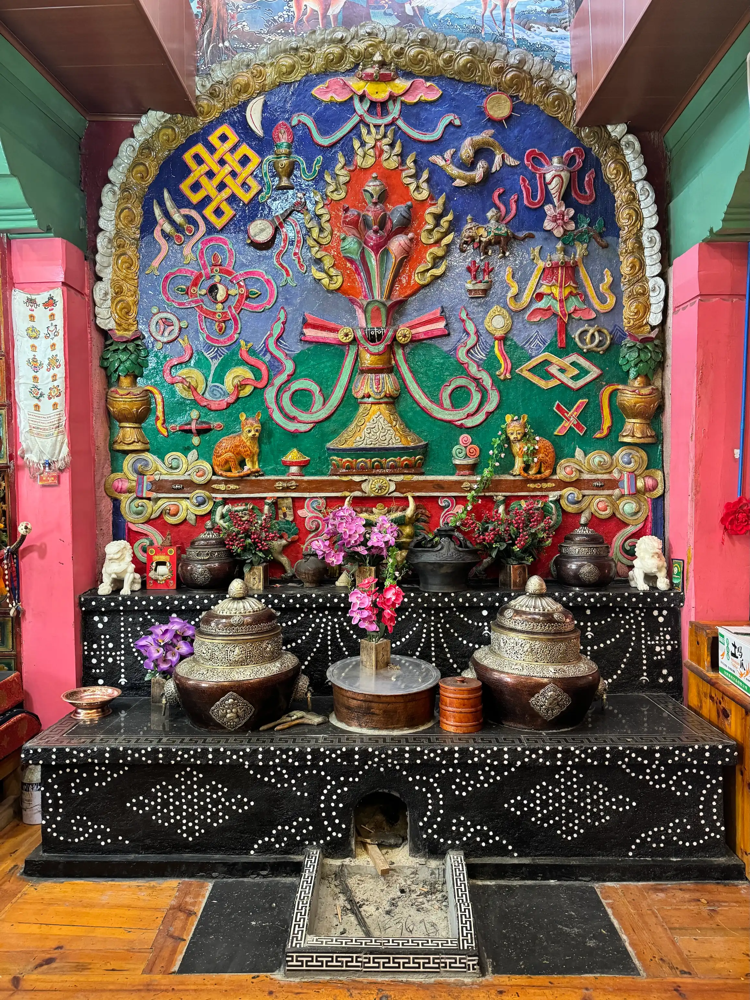
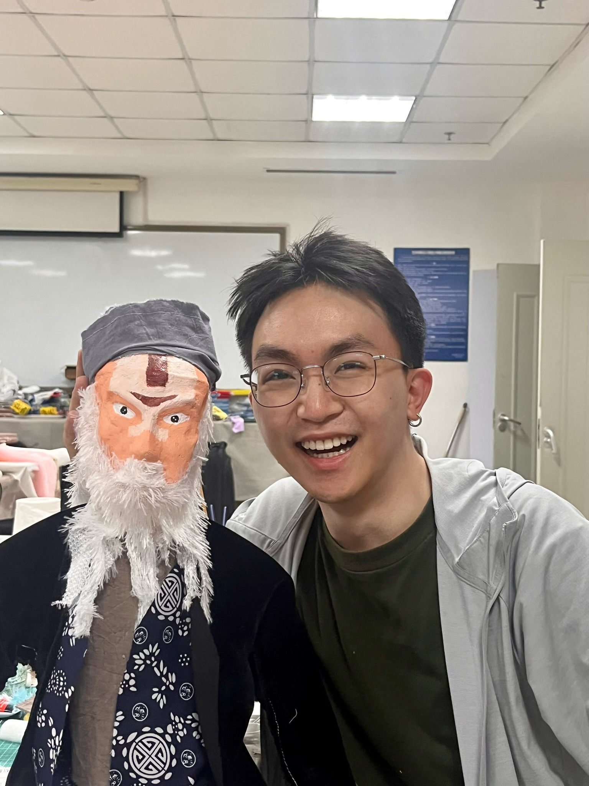
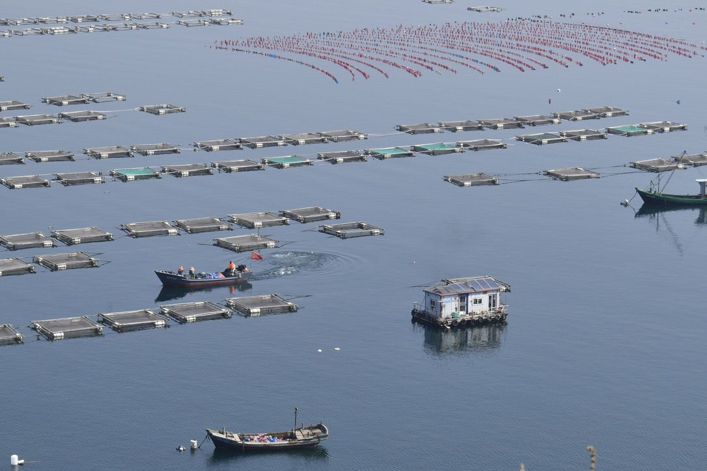
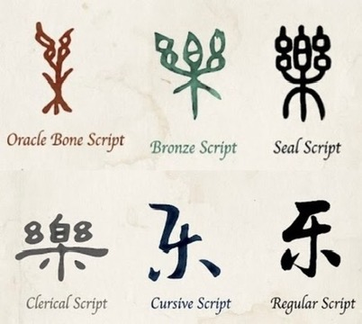
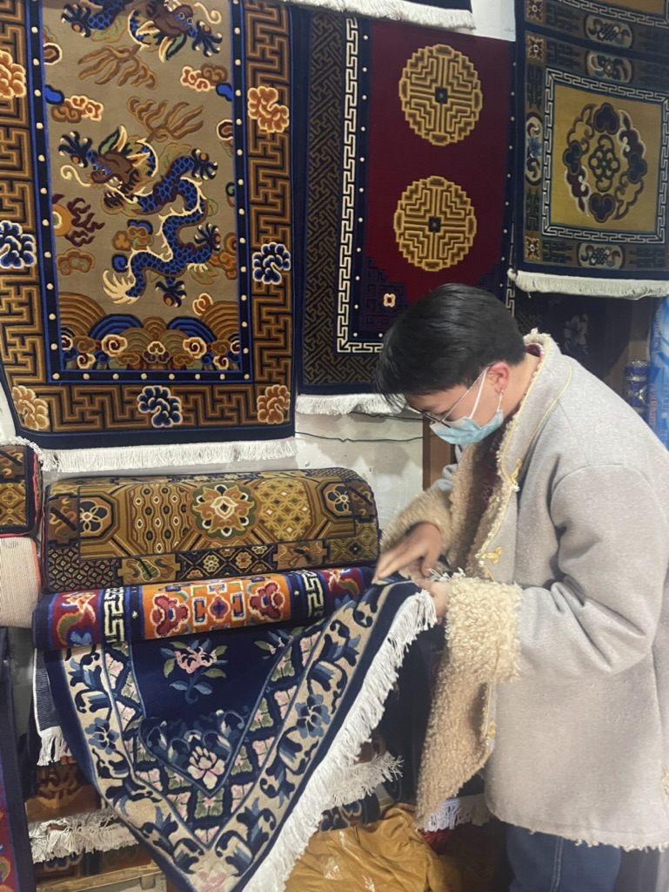
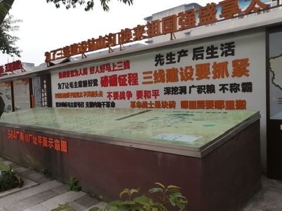
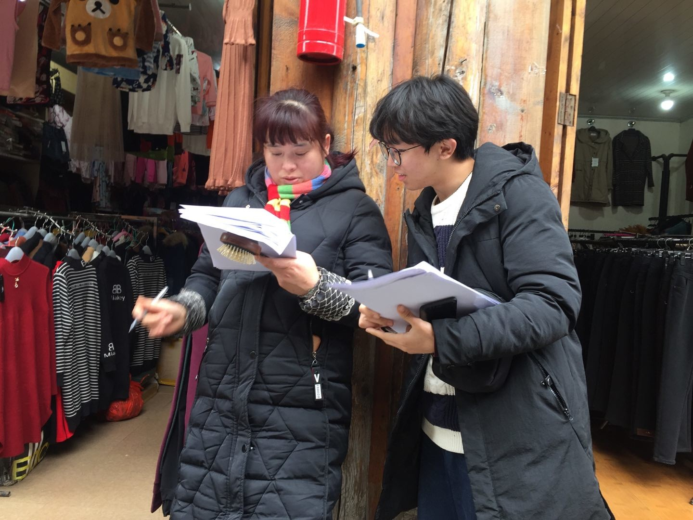

  

    

      
    

    

      <!-- 🛠️ 修改点：将 MyJost 换成了 LXGWWenKai -->
      <h6 class="fw-bold" style="font-family: 'LXGWWenKai', sans-serif; font-weight: 400; -webkit-text-stroke: 0.5px currentColor;">“唵”与“象”的对话 (10/2023 – 06/2025)</h6>
      

        在我的故乡乡城，家家户户的火塘带有鲜明的当地特色。人们在灶壁上绘制或雕刻与藏传佛教相关的图像，被装饰过的灶被尊称为“灶神”。多数灶墙形态相近，但有一幅图像格外引人注目：几乎每家每户都会出现一猫。猫在藏传佛教的图像中并不常见，那么它们为何会出现在这里，并受到如此礼遇？又为何在形态与功能上都与吐宝鼠鼬相似？我带着这些问题出发，循着它们走进了各个家庭对灶台周围图像的理解与照料方式。灶台成为我探索熟悉图像如何承载社会记忆、如何参与塑造地方与族群认同的一条路径。这也是我硕士论文所研究的内容。
      

      <a href="/zh/projects/om-and-xiang/" class="btn btn-sm btn-outline-info" style="font-family: 'MyJost', sans-serif;">探索更多</a>
    

  

  

    

      
    

    

      <!-- 🛠️ 修改点：将 MyJost 换成了 LXGWWenKai -->
      <h6 class="fw-bold" style="font-family: 'LXGWWenKai', sans-serif;font-weight: 400; -webkit-text-stroke: 0.5px currentColor;">辽西木偶戏的具身实践与文化传承 (06/2023 – 09/2023)</h6>
      

        在暑期三个月的时间里，我跟随教授以及木偶戏专家学习了戏剧理论，学会了制作木偶，并与当地剧团一起练习杖头木偶表演。参加排练和演出让我对学习一门手艺的意义有了不同的感受。当几个人必须在一个狭小的舞台上一起移动甚至舞蹈时，知识与信息都是通过示范、重复和身体的小幅调整来传递的。我开始思考，一场表演承载的不仅仅是故事：它还承载着让表演持续下去的人们的知识、记忆和关系。
      

    

  

  

    

      
    

    

      <!-- 🛠️ 修改点：将 MyJost 换成了 LXGWWenKai -->
      <h6 class="fw-bold" style="font-family: 'LXGWWenKai', sans-serif;font-weight: 400; -webkit-text-stroke: 0.5px currentColor;">遗产生态：中国农村的文化振兴 (11/2022 – 10/2023)</h6>
      

        在辽宁大连的蚆蛸岛，我开展了关于当地风俗与非物质文化遗产的田野调查，主要关注非遗与该岛生态及社区生活的联系。结合硕导团队所研究的其他案例，我们比较了中国不同乡村地区的经验，并思考文化保护应如何在更大程度上关注当地环境和社区参与。这是我第一次尝试在人们持续践行其文化的环境中研究文化遗产。这段经历使我更加贴近人们用以维系传统日常选择的现场，也让我看到文化延续与他们所居之地之间紧密的关联。
      

    

  

  

    

      
    

    

      <!-- 🛠️ 修改点：将 MyJost 换成了 LXGWWenKai -->
      <h6 class="fw-bold" style="font-family: 'LXGWWenKai', sans-serif;font-weight: 400; -webkit-text-stroke: 0.5px currentColor;">从仪式治理到审美超越：“乐”的符号学谱系 (11/2022 – 03/2023)</h6>
      

        汉字“乐”随着时间发展出了多种读音和含义，比如yuè 表示音乐，lè 表示欢乐和幸福，yào 表示喜爱或欣赏。我被这些含义之间的距离和联系所吸引。一个汉字怎么会承载如此不同的观念？通过历史文献，我追溯了它的含义如何在与仪式和政治秩序、个人情感以及审美思想的关系中发展。跟随一个汉字跨越不同时期，引出了关于语言、历史以及人们理解自身经验的方式的问题。
      

    

  

  

    

      
    

    

      <!-- 🛠️ 修改点：将 MyJost 换成了 LXGWWenKai -->
      <h6 class="fw-bold" style="font-family: 'LXGWWenKai', sans-serif;font-weight: 400; -webkit-text-stroke: 0.5px currentColor;">动物母题在藏毯中的转变 (06/2020 – 08/2020)</h6>
      

        在担任本科动物保护协会会长期间，我获得了一次开展研究项目的机会。我们对动物的共同兴趣，加上我在藏区的背景，吸引我们关注西藏地毯上的动物母题。我们想了解动物是如何被想象和描绘的，以及为什么某些母题能长期延续。
      

      

        随着研究的推进，我们发现地毯的图案、颜色和生产方法随着市场需求以及更广泛的经济和政策环境而变化。然而，一些动物母题保持相对稳定。我们还研究了地毯是如何生产、加工和销售的。最初对动物形象的兴趣，逐渐将我的注意力引向那些使这些形象得以延续或变化的人、材料和环境。
      

    

  

  

    

      
 
      

    

    

      <!-- 🛠️ 修改点：将 MyJost 换成了 LXGWWenKai -->
      <h6 class="fw-bold" style="font-family: 'LXGWWenKai', sans-serif;font-weight: 400; -webkit-text-stroke: 0.5px currentColor;">基层群众参与社区治理的现状研究 (11/2019 – 02/2021)</h6>
      

        本科的课程和实践让我对“为什么居民参与在成都各城市社区中的运作方式有很大不同”产生了兴趣。一些获奖的社区已经形成了有效的居民参与方式，而另一些社区虽然参与活跃，但成效有限。于是我们决定更深入地考察几个基层治理成效良好的社区。通过访谈和问卷调查，我们探究了他们在社区参与方面的做法，借鉴了他们的经验，并提出了适合不同地方条件的建议。这项研究也改变了我对基层政治的看法。我的课程主要让我了解到地方政府和基层党组织的角色重要性，但通过这个项目我开始意识到，很多事情还取决于居民的日常需求、邻里关系，以及人们围绕共同事务所作出的决定。这个项目后来也是我学士学位论文的基础。
      

    

  

  

    

      
    

    

      <!-- 🛠️ 修改点：将 MyJost 换成了 LXGWWenKai -->
      <h6 class="fw-bold" style="font-family: 'LXGWWenKai', sans-serif;font-weight: 400; -webkit-text-stroke: 0.5px currentColor;">红色革命遗址的视觉文化与物质记忆研究 (11/2018 – 06/2019)</h6>
      

        与井冈山等知名革命遗址相比，四川的一些革命老区尽管具有深刻的历史和政治意义，却受到关注的程度要低得多。这促使我们在广元、泸州等地开展田野调查。我们探讨了当地政府和居民如何保存、展示并传承他们自己的革命历史。通过访谈、问卷调查和跨遗址比较，我们这些地区的未来发展提出了切实可行的建议。令我印象深刻的是，我对历史场所和物品的看法发生了转变。它们不仅仅是已然过去的事件的提醒物。它们的物质存在也塑造了人们理解历史以及体验周围环境的方式。这是我对视觉与物质文化产生兴趣的早期转折点。
      

    

  

 

<!-- ==========================================
 🧙‍♂️ 强制注入：当前页面的导航栏字体与颜色魔法
 为什么要放在最下面？
 因为在 HTML 渲染时，越靠下的代码优先级越高 (Cascading)。
 放在最后能确保它覆盖掉默认主题的所有样式！
 ========================================== -->

